<div align="center">


<!-- Animated avatar: upload assets/avatar.svg to your repo -->


<!-- Orbitron: futuristic display font -->


<!-- Fira Code: clean coding font -->


<br/>


</div>

---

<h2> </h2>

```bash
divay@github:~$ cat about.txt

Name       : Divay Sachdeva
Role       : Computer Science Engineering Student
Skills     : Python, C, Linux, Git/GitHub, VS Code
Learning   : Data Structures & Algorithms, Shell scripting, Open Source
Practice   : Solving problems on LeetCode
Interests  : Problem solving, exploring new tech
Motto      : Always ready to learn and collaborate

divay@github:~$ _
```

<div align="center">

| 🔭 Working on | 🌱 Learning | 🎯 Goal |
|:---:|:---:|:---:|
| Python & C projects | DSA, Linux internals | Become a strong software engineer |

</div>

---

<h2> </h2>

<div align="center">


</div>

---

<h2> </h2>

<div align="center">


</div>

---

<h2> </h2>

<div align="center">


</div>

---

<h2> </h2>

<div align="center">

<a href="https://leetcode.com/u/Divay9671/"></a>


</div>

---

<h2> </h2>

<div align="center">

| Project | What it does | Stack | Links |
|:--|:--|:--|:--|
| 🐍 **Project One** | One-line pitch of the problem it solves | `Python` | [Code](#) |
| ⚙️ **Project Two** | One-line pitch of the problem it solves | `C` `Linux` | [Code](#) |
| 🌐 **Project Three** | One-line pitch of the problem it solves | `Python` | [Live](#) · [Code](#) |

</div>

> Replace the placeholders with your real projects and add a screenshot or GIF for each.

---

<h2> </h2>

<div align="center">

| 🏏 Cricket | 🏸 Badminton | ✈️ Travelling | 👨‍👩‍👧‍👦 Family & Friends |
|:---:|:---:|:---:|:---:|
| Weekend matches | Court battles | Exploring new places | Time that matters most |

</div>

---

<h2> </h2>

- [x] Learn Python and C fundamentals
- [x] Get comfortable with Linux and Git/GitHub
- [ ] Build and publish 3 solid projects
- [ ] Solve 100+ problems on LeetCode
- [ ] Contribute to open source
- [ ] Land a software internship

---

<h2> </h2>

<div align="center">

<a href="mailto:sachdevadivay300@gmail.com"></a>
<a href="https://github.com/sachdevadivay"></a>
<a href="https://www.linkedin.com/in/divay-sachdeva-41a764376/"></a>
<a href="https://leetcode.com/u/Divay9671/"></a>
<a href="https://instagram.com/sachdeva.divay"></a>

<br/><br/>


**⭐ If you like my work, give it a star! ⭐**

</div>
